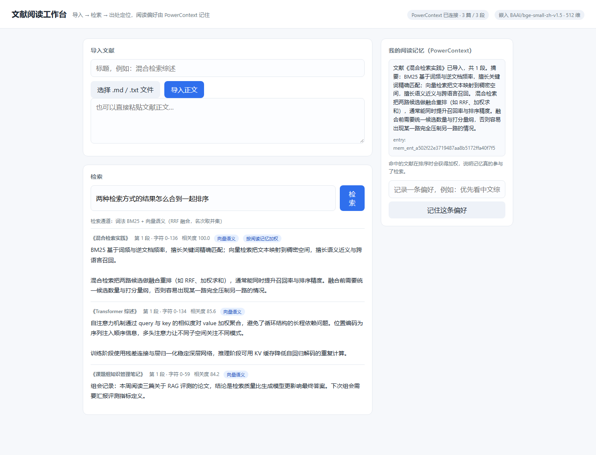

# Qoder 开发记录

评审用：说明 Qoder 在需求拆解、编码、调试等环节完成了什么。截图/录屏放在 `docs/images/` 下并在此引用。

- Qoder 账号 UID：（待填写，登录 Qoder 后在账号信息中查看）
- 使用形态：Qoder CN 桌面端（Agent 模式）/ IDE（按实际填写）
- 开发周期：2026-10-29 ~ （待填写）

| # | 环节 | Qoder 承担的工作 | 证据 |
| --- | --- | --- | --- |
| 1 | 赛题与环境勘察 | 抓取赛题/提测/GitHub 文档，梳理硬性约束：分支 `2026-competition-ecosystem`、`qoder/` 目录、公开 Sites、每日 10 次提测 | （截图：需求梳理对话） |
| 2 | 仓库与依赖 | 切换 origin 到团队仓库、拉全历史；安装 PowerContext 1.2.0、生成并校验 `.env` | （截图：安装与 `config validate`） |
| 3 | 组件验证 | 编写 `tools/verify_powercontext.py`，打通 Scope → Memory → 检索断言 | `artifacts/verify-powercontext.json` |
| 4 | 需求拆解 | 按「文献/资料混合检索」方向定功能边界：导入切分、出处定位、阅读记忆、偏好沉淀 | （截图：方案确认对话） |
| 5 | 编码 | 生成 `app/` 五个模块与单页界面（标准库实现，零第三方依赖） | （截图：代码生成对话） |
| 6 | 调试 | 修复三处真实缺陷：`citation` 与 `text` 同级导致的 KeyError；中文整句 trigram 无法命中（改为短语优先 + 三元组 OR 召回）；bm25 量纲过小（改为相对相关度） | （截图：报错与修复） |
| 7 | 端到端验证 | 编写 `tools/verify_literature.py`，覆盖导入、检索、出处、记忆复用 | `artifacts/verify-literature.json` |
| 8 | 本地嵌入与混合检索 | 生成 `tools/embed_server.py`（OpenAI 兼容 `/v1/embeddings`，fastembed + `bge-small-zh-v1.5`）；补 `app/embedding.py` 与 `chunk_vectors`；`app/search.py` 改为词法+向量 RRF 融合；历史分块启动时自动回填向量；PowerContext `.env` 接入同一嵌入服务，`search_modes` 由 `auto, fts` 扩展为 `auto, fts, vector, hybrid` | `artifacts/verify-literature.json`、`artifacts/verify-powercontext.json` |
| 9 | 站点发布 | 编写 `site/`（简介、功能、架构、真实结果回放、验证证据、运行步骤），用 `tools/build_site_data.py` 把 `artifacts/verify-literature.json` 导出为演示数据，发布到 <https://literature-desk-olizvin1uxl.qoder.zone>（公开） | 界面截图：`docs/images/ui-search.png` |
| 10 | 提测材料与自检 | 生成 `docs/submission.md`（表单字段、7 条功能宣称与证据对照、复现路径、自检表、访问统计）与 `tools/preflight.py`；自检覆盖 SHA/分支一致性、`.env` 是否被跟踪、凭据与本机路径泄漏、站点匿名可达、验证证据、本机三服务在线，修复了脚本里 `global` 声明顺序导致的 SyntaxError | `artifacts/preflight.json`（2026-10-30 校验通过，仅剩工作区未提交） |

界面截图（真实运行，检索「两种检索方式的结果怎么合到一起排序」）：

> 注意：主要功能必须在 Qoder 中开发完成；仅在 Qoder 发布网站、代码在别处写的不符合赛题要求。
